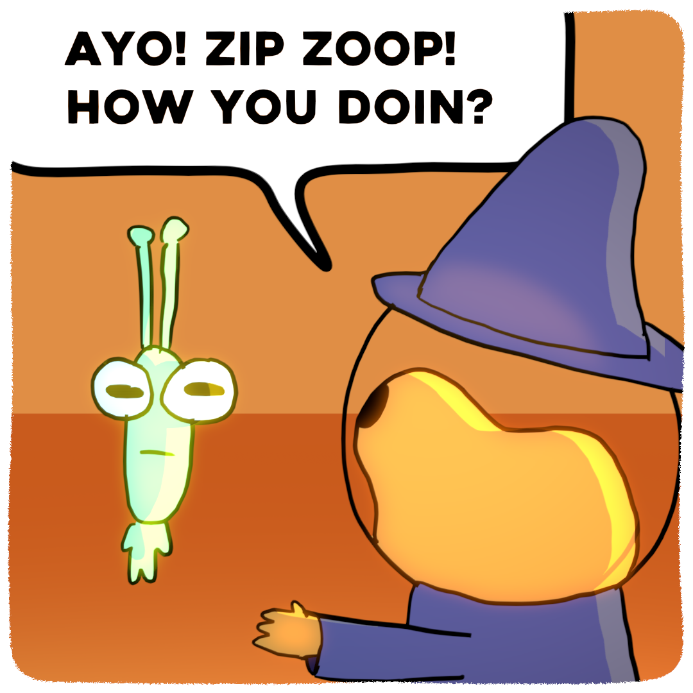
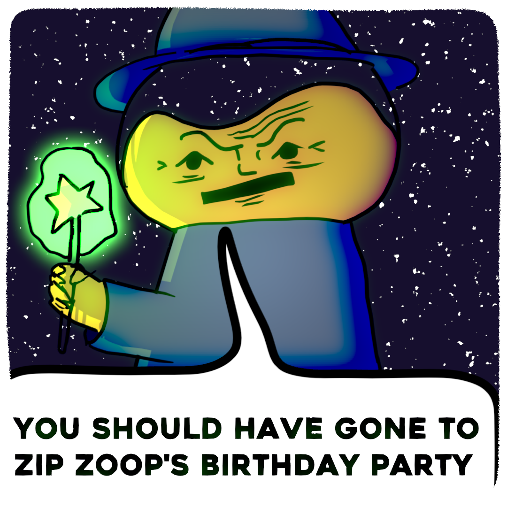
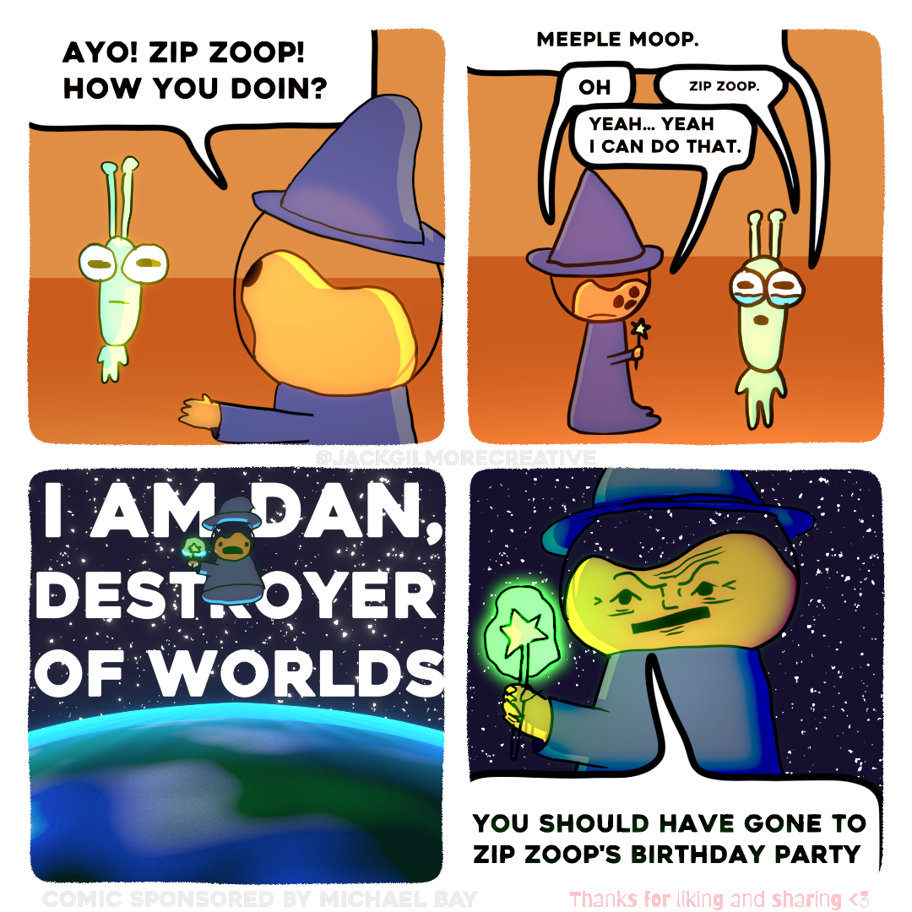

#+title: Comics

# This file is the comics page. The site reads it directly, so saving it and
# pushing is all an update takes. (In Emacs: SPC n w c opens it.)
#
# - Put the images in the comics/ folder of the website.
# - A heading with :KIND: series is an ongoing comic (the "series" view). Each
#   heading under it is an issue (or a chapter, if it has issues under it).
# - Any other heading is a group in the gallery; each comic under it is a card.
# - A comic's pages are the image links under its heading, one per line, in
#   reading order. Links are relative to this file, so start them with
#   ../comics/ (C-c C-l in Emacs inserts one; C-c C-x C-v previews them):
#     [[file:../comics/hat-guy/01-1.png]]
#     [[file:../comics/hat-guy/01-2.png]]
# - Properties: :DATE: 2026-10-25, :COVER: ../comics/x.png (else the first page).
#   The other text under a heading is its description.
# - Start a heading with COMMENT to hide it without deleting it.

* The Adventures of Dan The Space Wizard
:PROPERTIES:
:KIND: series
:END:
Short comics about Dan the Space Wizard and his wacky adventures.

** Zip Zoops Birthday Party
:PROPERTIES:
:DATE: 2026-10-25
:END:

* COMMENT Panels
** Example single panel
[[file:../comics/example.png]]
